  

# 🚀 Awesome Employee & Customer Referral Management

  
  
  
  
  
  

---

## 📌 Top Employee & Customer Referral Management Ecosystem

> **A curated collection of SaaS platforms, self-hosted open-source software, and growth infrastructure.**  
> *Targeted for word-of-mouth customer acquisition, employee referral rewards, affiliate attribution tracking, and partner portals.*  
> **Last updated: March 2026**

This repository tracks the most impactful **SaaS platforms** and **open-source projects** for **Employee & Customer Referral Management**. These software solutions empower growth teams, HR talent leaders, and engineers to build, automate, and scale viral referral loops—spanning multi-tier affiliate tracking, customer advocacy rewards, edge-based link attribution, fraud detection, and internal employee recruitment bonuses.

---

## 📑 Table of Contents
- [📊 Sector Overview & Market Dynamics](#-sector-overview--market-dynamics)
- [🏢 SaaS/Hosted Platforms](#-saashosted-platforms)
- [💻 Open-Source GitHub Projects](#-open-source-github-projects)
- [📈 Star History](#-star-history)
- [🤝 How to Contribute](#-how-to-contribute)
- [💖 Support](#-support)
- [⚠️ Disclaimer](#-disclaimer)

---

## 📊 Sector Overview & Market Dynamics

The global referral and advocacy marketing software sector is estimated at **$1.4B to $1.5B** (projected to exceed **$2.7B** by 2030 at ~13% CAGR), propelled by escalating customer acquisition costs (CAC), rising performance advertising fatigue, and cookie deprecation. 

The industry demonstrates **moderate fragmentation** rather than winner-take-all dominance:
- **Enterprise Suites:** Platforms like Mention Me and Extole lock in mid-market and enterprise D2C brands via white-glove onboarding, robust compliance, and custom reward fulfillment.
- **Mid-Market & E-Commerce SaaS:** Platforms such as Friendbuy, ReferralCandy, and Referral Factory dominate turnkey e-commerce store setups with self-serve automation.
- **Open-Source & Self-Hosted Infrastructure:** Modern open-source options (e.g., RefRef, RefearnApp, AffiliateTracking) are rapidly capturing engineering teams seeking **data privacy, ledger transparency, and zero revenue-share penalties** on recurring business revenue.

---

## 🏢 SaaS/Hosted Platforms

| Product | Company Size (Est. Revenue / Valuation) | Pricing (Starting Tier) | Free Tier Limits | Description |
|---|---|---|---|---|
| **[Mention Me](https://www.mention-me.com/)** | ~$10M–$25M ARR / ~$100M Valuation ($32M funding) | Custom / Quote-based (typically scales with AOV and online order volume) | No free tier; free trial available by sales consultation / custom demo | Enterprise referral marketing & customer advocacy platform popular in UK/Europe for mid-market and enterprise D2C brands. |
| **[Extole](https://www.extole.com/)** | ~$10M–$15M ARR / $54.2M Funding | From **$999/month** (App/Mid-market tier for <$10M GMV; enterprise up to $120k+/yr) | No free tier; no self-serve free trial (guided demo & evaluation with sales) | Enterprise referral marketing, partner programs, and customer-led growth platform with deep API/SDK support. |
| **[Talkable](https://www.talkable.com/)** | ~$11M ARR / $4.8M Funding | From **$800/month** (core managed plans typically $12k–$30k/yr; Shopify entry tier from $59/mo) | No free tier; no public free trial (requires sales consultation and demo) | Enterprise referral marketing platform for high-growth e-commerce and SaaS, focused on multi-variant A/B testing and fraud controls. |
| **[Friendbuy](https://www.friendbuy.com/)** | ~$5.5M–$6M ARR / $1.8M Funding | From **$249/month** (Starter tier billed annually) | No permanent free tier; 14-day free trial available on self-serve onboarding | Referral and loyalty platform tailored for e-commerce and fast-scaling direct-to-consumer (DTC) brands. |
| **[ReferralCandy](https://www.referralcandy.com/)** | ~$4.6M–$5.2M ARR / ~$778K Funding | From **$39/month** (Basic plan + 10.5% success fee on referral sales) | No permanent free tier; 7-day free trial on all plans (full feature access) | E-commerce referral and affiliate program software for Shopify, BigCommerce, and WooCommerce. |
| **[Ambassador](https://ambassador.com/)** | ~$4.3M ARR / $50.9M Funding | From **$125/month** (Starter tier; custom scaling for mid-market/enterprise) | No permanent free tier; demo/trial provisioned upon request with sales team | Referral marketing, affiliate tracking, and relationship management platform for mid-market brands. |
| **[Referral Factory](https://referralfactory.com/)** | ~$2M–$3M ARR / ~€500K Funding | From **$200/month** (Basic plan; $160/mo billed annually) | No permanent free tier; 15-day free trial (up to 20,000 campaign participants) | No-code referral program builder with plug-and-play templates and native CRM integrations. |
| **[SaaSquatch](https://saasquatch.com/)** | ~$1.1M–$2M ARR / Venture-backed | From **$500/month** (Standard plan; custom enterprise tiers available) | No free tier; no self-serve free trial (demo and evaluation sandbox via sales) | Enterprise loyalty and referral platform supporting complex reward workflows and multi-tenant architectures. |

---

## 💻 Open-Source GitHub Projects

Curated self-hosted and open-source engines for referral programs, affiliate tracking, employee hiring referrals, and commission management.

*Sorted by GitHub Stars_Count in descending order:*

| Project | Stars_Badge | Tech Stack | License | Description |
|---------|------------|------------|---------|-------------|
| **[RefRef](https://github.com/refrefhq/refref)** |  | TypeScript, Next.js, Docker, PostgreSQL | MIT | **Self-hosted referral and affiliate marketing platform you can launch in minutes.** Features JS snippet attribution, customizable reward structures, dedicated advocate/referrer portals, partner affiliate dashboards, and automated email nudges. |
| **[laravel-referral](https://github.com/voocx/laravel-referral)** |  | PHP, Laravel | MIT | **Comprehensive referral management package for Laravel.** Adds effortless referral tracking, cookie expiration handling, customizable token generators, and relationship models for rewarding referrers on signup and purchase actions. |
| **[laravel-referral (jijunair)](https://github.com/jijunair/laravel-referral)** |  | PHP, Laravel | MIT | **Extensible Laravel referral system package.** Handles referral link generation, tracking incoming referrals via middleware, attribution persistence in sessions/cookies, and triggering custom referral reward events. |
| **[elitius](https://github.com/intelliants/elitius)** |  | PHP, MySQL | GPL-2.0 | **Full-featured self-hosted affiliate tracking software.** Includes comprehensive affiliate management, customizable Smarty templates, commission payout accounting, and multi-tier tracking tools. |
| **[Usher Referrals](https://github.com/usherlabs/usher-referrals)** |  | TypeScript, Node.js, Web3 | Apache-2.0 | **Decentralized referral and partnership attribution engine with Web3 integration.** Enables cross-chain conversion attribution, smart contract incentives, and partner performance tracking for Web3 protocols and dApps. |
| **[Referalah](https://github.com/Pjaijai/Referalah)** |  | TypeScript, React, Node.js | MIT | **Open-source community referral and job referral sharing platform.** Allows professionals and employees to share internal company job openings, track applicants, and manage referral requests. |
| **[django-referral-system](https://github.com/soldatov-ss/django-referral-system)** |  | Python, Django | MIT | **Plug-and-play Django referral engine.** Track promoters, reward commissions, and manage payouts. Features unique referral tokens/links, activation and click tracking, Wise CSV export for payouts, automatic refund reversals, and HTML invite emails. |
| **[kumatrk](https://github.com/kumatrk/initialrelease)** |  | Go, Vue.js, SQLite | MIT | **Simple Kuma — self-hosted ad & affiliate tracker.** Real-time campaign statistics, Meta/Google Ads cost synchronization, conversion postback tracking, and clean REST API. |
| **[refearnapp](https://github.com/zak123dsfdf/refearnapp)** |  | Next.js, Cloudflare Workers, Redis, Postgres | AGPL-3.0 | **High-scale edge-native affiliate tracking & referral management.** Features sub-millisecond link redirects via Cloudflare Workers, real-time conversion telemetry, Stripe & Paddle integration, PayPal mass payouts, coupon tracking, and branded affiliate portals. |
| **[ReferralNetworkHub](https://github.com/RutikKulkarni/ReferralNetworkHub)** |  | JavaScript, React, Node.js, Express, MongoDB | MIT | **Employee job referral portal.** Bridges talent with working professionals inside companies to facilitate internal corporate job referrals, tracking candidate application stages from submission to interview. |
| **[rails-referral-tracking](https://github.com/danvoell/rails-referral-tracking)** |  | Ruby, Ruby on Rails | MIT | **Dropbox-style referral mechanism for Ruby on Rails applications.** Lightweight referral code generator, session cookie tracker, and user signup credit engine for viral product onboarding loops. |
| **[affiliate-tracking](https://github.com/thebigasif/affiliate-tracking)** |  | Go, SQLite, Docker | AGPL-3.0 | **Fraud-resistant affiliate tracking with a double-entry ledger.** Single Go binary with built-in SQLite/Postgres. Handles Stripe, Paddle, Chargebee, Lemon Squeezy, Polar, and Recurly. Includes 13 automated fraud prevention rules, branded partner portals, and an MCP server for AI assistants. |
| **[affiliate-management-system](https://github.com/prathammahajan13/affiliate-management-system)** |  | Node.js, Express, MongoDB | MIT | **Modular affiliate and referral management backend.** Supports referral link generation, multi-tier commission structures, affiliate conversion webhooks, and payout logs. |

---

## 📈 Star History

---

## 🤝 How to Contribute

Contributions are warmly welcomed! Help grow this knowledge base:

1. 🍴 **Fork the repo.**
2. 🌿 **Create your feature branch:** `git checkout -b feature/new-referral-tool`
3. 📝 **Add or update entries in `README.md`:** Maintain table schemas and Stars_Badge standards (`style=social&color=white`). Ensure links point directly to stargazers and official landing pages.
4. 💡 **Include:** Tool name, URL, short factual description, pricing/licensing details.
5. 🚀 **Submit a Pull Request** with a brief summary of the project added.

---

## 💖 Support

Thank you for exploring and utilizing this curated ecosystem! 🌟

If this project has saved you hours of research, helped you build an open-source referral stack, or provided valuable market clarity, please consider supporting the project:
- ⭐ **Star this repository** to improve visibility and help other builders discover it.
- 🍴 **Fork and share** with your growth marketing, product, and engineering teams.
- ☕ **Buy me a coffee / Become a sponsor:** Support continued open-source research and directory curation on the [GitHub Sponsors Dashboard](https://github.com/sponsors/ishandutta2007).

---

## ⚠️ Disclaimer

- This repository is a **community-curated index** for informational, architectural, and educational purposes. Inclusion does not constitute an endorsement.
- Referral and affiliate platforms process financial payouts, commission allocations, and user PII. Implement strict anti-fraud safeguards (cookie spoofing, self-referrals, click flooding) and verify legal/tax compliance (W-9/W-8BEN, VAT, FTC endorsement guidelines).
- Commercial pricing is subject to vendor updates; always review official vendor pages before making enterprise commitments.

---

  <b>Built with ❤️ for growth marketers, product engineers, and developers building referral infrastructure.</b>

